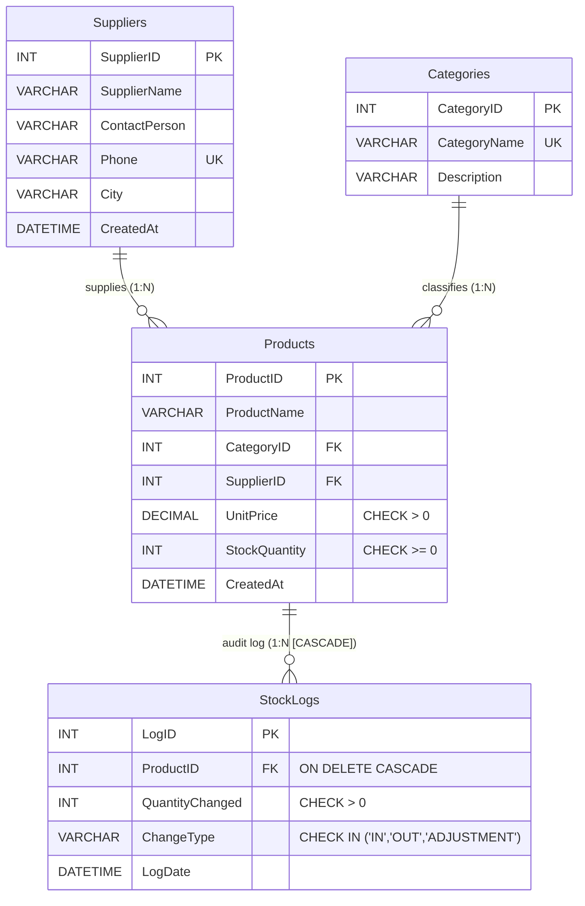

# Retail Store Inventory and Supplier Management System
**Academic Database Architecture & Interactive Web Dashboard**

---

## 📌 Project Overview
The **Retail Store Inventory and Supplier Management System** is a production-grade, 3rd Normal Form (3NF) relational database project coupled with an interactive modern enterprise web dashboard. 

The system tracks suppliers, product categories, inventory valuation, stock thresholds, and multi-directional inventory audit logs (`'IN'` shipments, `'OUT'` sales dispatches, and `'ADJUSTMENT'` audit reconciliations).

---

## 🏗 Database Architecture & Relational Model

### Entity-Relationship Diagram (ERD)



### Relational Schema & Cardinality Specifications

```
+-----------------------------------------------------------------------------------+
|                              ENTITY-RELATIONSHIP MAP                              |
+-----------------------------------------------------------------------------------+
|                                                                                   |
|   [Suppliers] (1) <------------------------------------- (N) [Products]           |
|   PK: SupplierID                                             PK: ProductID        |
|                                                              FK: SupplierID       |
|                                                              FK: CategoryID       |
|   [Categories] (1) <------------------------------------ (N)      |               |
|   PK: CategoryID                                                  | (1)           |
|                                                                   |               |
|                                                                   v (N, CASCADE)  |
|                                                              [StockLogs]          |
|                                                              PK: LogID            |
|                                                              FK: ProductID        |
+-----------------------------------------------------------------------------------+
```

### Referential Integrity & Constraints
1. **Primary Keys:** Every table features an auto-incrementing integer surrogate primary key (`SupplierID`, `CategoryID`, `ProductID`, `LogID`).
2. **Business Constraints:**
   - `UnitPrice > 0`: Prevents non-positive pricing.
   - `StockQuantity >= 0`: Guarantees non-negative inventory counts.
   - `QuantityChanged > 0`: Ensures log entries record strictly positive magnitude changes.
   - `ChangeType IN ('IN', 'OUT', 'ADJUSTMENT')`: Restricts transaction taxonomy.
3. **Foreign Keys:**
   - `Products.CategoryID -> Categories.CategoryID`: `ON UPDATE CASCADE ON DELETE RESTRICT` (Prevents orphan products if category is purged).
   - `Products.SupplierID -> Suppliers.SupplierID`: `ON UPDATE CASCADE ON DELETE RESTRICT` (Protects active vendor references).
   - `StockLogs.ProductID -> Products.ProductID`: `ON UPDATE CASCADE ON DELETE CASCADE` (Automatically purges audit history when a product is discontinued).

---

## 🚀 Quickstart Guide

### Option 1: Run the Complete Web Application (Zero Setup Required)
The project includes a built-in zero-dependency Node.js engine backed by native SQLite 3NF storage.

1. Navigate to the project root:
   ```bash
   cd C:\Users\shiv\.gemini\antigravity\scratch\retail-inventory-system
   ```
2. Start the server (Node 22+):
   ```bash
   node server.js
   # or: npm start
   ```
3. Open your browser:
   ```
   http://localhost:3000
   ```

### Option 2: Execute Standalone MySQL 8.0 Scripts
All standard ANSI MySQL 8.0 scripts are located in the `sql/` directory:
- `sql/01_schema_mysql.sql`: DDL statements creating database, tables, and constraints.
- `sql/02_sample_data_mysql.sql`: DML statements populating 6 suppliers, 6 categories, 14 products, and 18 stock logs.
- `sql/03_analytical_queries_mysql.sql`: The 8 core business queries with full comments.
- `sql/04_views_mysql.sql`: Creates `vw_reorder_report` and analytical views.
- `sql/99_cleanup_mysql.sql`: Reset script to drop all objects in reverse dependency order.

To execute via MySQL CLI:
```bash
mysql -u root -p < sql/01_schema_mysql.sql
mysql -u root -p retail_inventory_db < sql/02_sample_data_mysql.sql
mysql -u root -p retail_inventory_db < sql/03_analytical_queries_mysql.sql
```

---

## 📊 Core Business & Analytical Queries (Module 3)

The project implements and documents 8 standard academic business queries:

1. **Multi-Table INNER JOIN:** Comprehensive catalog linking `Products`, `Categories`, and `Suppliers` with location and on-hand units.
2. **Low-Stock Alert with `GROUP BY` and `HAVING`:** Aggregates stock by category to isolate departments with less than 35 total units.
3. **Nested Subqueries:**
   - *3A (Uncorrelated):* Finds products commanding prices strictly above store-wide average.
   - *3B (Correlated):* Returns the flagship (highest-priced) product within each category.
4. **Financial Valuation Summary:** Aggregates inventory valuation ($\sum UnitPrice \times StockQuantity$) broken down by Category and Supplier.
5. **Stock Movement Analysis (`CASE WHEN`):** Conditional aggregation computing units restocked (`'IN'`) versus dispatched (`'OUT'`).
6. **LEFT JOIN Gap Analysis:** Identifies suppliers and categories with zero active products (`ProductID IS NULL`).
7. **Database View (`vw_reorder_report`):** Real-time procurement view isolating items with stock $< 15$ units alongside vendor contact details.
8. **Cascading Delete Demonstration:** Transaction-safe execution demonstrating automatic cleanup of child audit rows upon parent product deletion.

---

## 💻 Web Dashboard Features

- **Dashboard:** Live valuation card, SKU counter, active vendor network status, and critical stock warnings.
- **Visual Turnover Trends:** CSS/SVG proportional bars contrasting shipments received vs orders dispatched.
- **Product Catalog (CRUD):** Live search, category and supplier filters, low-stock toggle, Add Product modal with inline constraint checking, Edit modal, and delete with cascade confirmation.
- **Procurement & Reorder Report:** Direct table view of `vw_reorder_report` with quick dial/copy supplier contact and `"Generate PO"` authorization modal.
- **Audit Ledger:** Chronological feed tracking all stock transactions with color-coded badges (`'IN'` Green, `'OUT'` Rose, `'ADJUSTMENT'` Amber).
- **Academic SQL Query Explorer:** Interactive tab allowing professors or students to select any of the 8 queries, review the SQL syntax, and inspect live tabular results.
- **Factory Reset Button:** Restores the database to its pristine sample data state at any time.

---

## 📁 Project Directory Structure

```
retail-inventory-system/
├── package.json               # Node.js project manifest
├── server.js                  # REST API server & native SQLite database manager
├── README.md                  # Comprehensive technical documentation & ERD
├── data/
│   └── inventory.db           # Auto-generated SQLite database file
├── sql/
│   ├── 01_schema_mysql.sql    # MySQL DDL (Tables, Constraints, Indexes)
│   ├── 02_sample_data_mysql.sql# MySQL DML (14 Products, 6 Suppliers, 18 Logs)
│   ├── 03_analytical_queries_mysql.sql # 8 Academic Business Queries
│   ├── 04_views_mysql.sql     # Database Views (vw_reorder_report)
│   ├── 99_cleanup_mysql.sql   # Teardown script (Reverse DROP)
│   └── schema_sqlite.sql      # Local database initialization script
└── public/
    ├── index.html             # High-density enterprise dashboard UI
    └── app.js                 # Frontend SPA controller and API client
```
